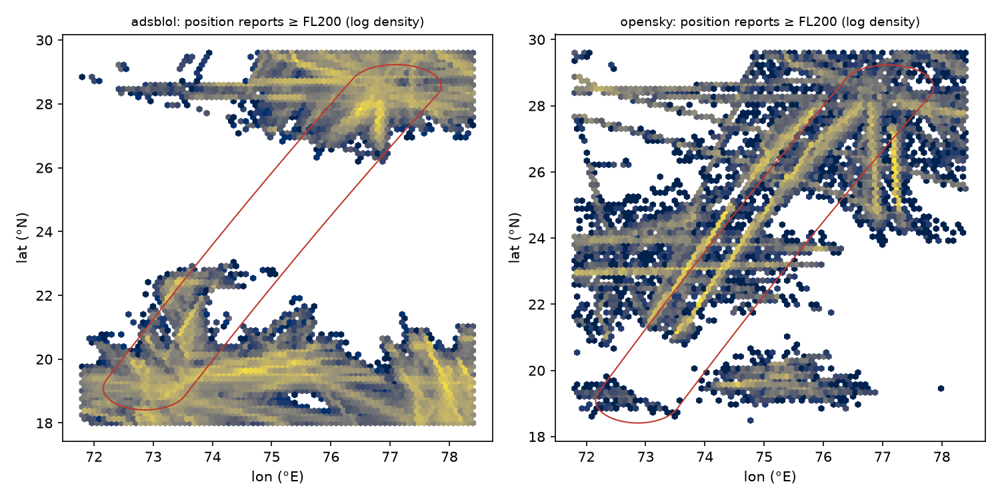
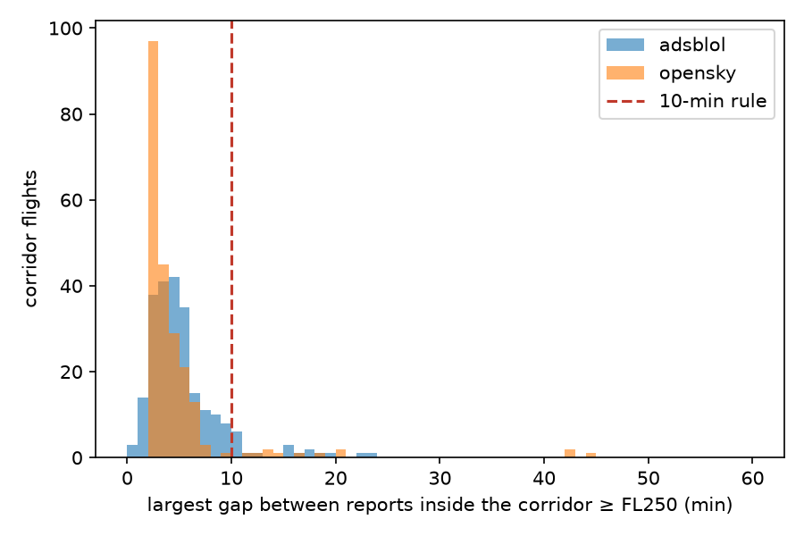

# Coverage audit — Delhi–Mumbai corridor

Rule (paper §3.3, pre-registered): opensky if the end-to-end fraction ≥ 0.5 (cruise track crosses the corridor, max gap 10 min) else adsbx.

**Decision (mechanical): `adsbx`** — OpenSky pooled end-to-end fraction 0.406 < 0.5.

*End to end* (the rule's measure, D-007): no gap > 10 min **and** seen north of
26°N and south of 22°N (across the corridor's middle).
*Continuous* is the first version (gaps between reports only; half a route counted).

| date | source | direction | scheduled | observed | continuous | end to end | fraction |
|---|---|---|---|---|---|---|---|
| 2026-11-05 | adsblol | DEL-BOM | 62 | 38 | 38 | 0 | 0.00 |
| 2026-11-05 | adsblol | BOM-DEL | 63 | 19 | 18 | 0 | 0.00 |
| 2026-11-06 | adsblol | DEL-BOM | 60 | 27 | 27 | 0 | 0.00 |
| 2026-11-06 | adsblol | BOM-DEL | 63 | 14 | 13 | 0 | 0.00 |
| 2026-11-07 | adsblol | DEL-BOM | 62 | 5 | 5 | 0 | 0.00 |
| 2026-11-07 | adsblol | BOM-DEL | 62 | 6 | 5 | 0 | 0.00 |
| 2026-11-08 | adsblol | DEL-BOM | 48 | 8 | 8 | 0 | 0.00 |
| 2026-11-08 | adsblol | BOM-DEL | 48 | 1 | 1 | 0 | 0.00 |
| 2026-11-10 | adsblol | DEL-BOM | 65 | 14 | 14 | 0 | 0.00 |
| 2026-11-10 | adsblol | BOM-DEL | 63 | 20 | 18 | 0 | 0.00 |
| 2026-11-10 | opensky | DEL-BOM | 65 | 63 | 60 | 52 | 0.80 |
| 2026-11-10 | opensky | BOM-DEL | 63 | 17 | 13 | 0 | 0.00 |

